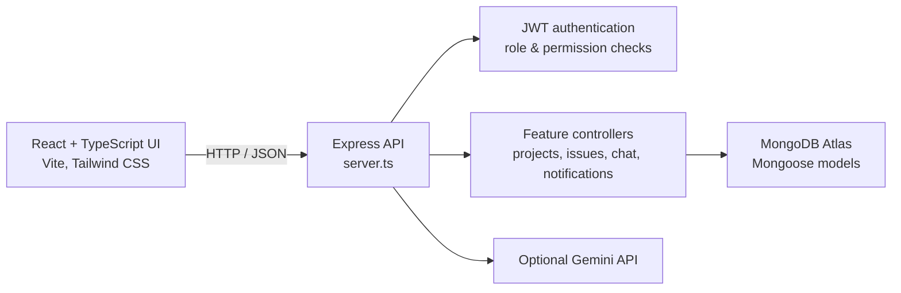

# PulseDev

**A role-aware workspace for planning sprints, reviewing work, and keeping a product team in sync.**

PulseDev brings an initiative overview, sprint board, QA workflow, team chat, notifications, and an AI-assisted planning workspace into one web application. It is built to make day-to-day delivery visible while keeping important actions—especially QA approval and issue ownership—behind clear, server-enforced permissions.

> **Live demo:**
> <!-- Add the deployed application URL here when it is ready. -->

## Why PulseDev

Teams often spread planning, delivery status, review feedback, and team conversations across separate tools. PulseDev puts those workflows in one place and gives each role a focused view of the work:

- Developers can see and advance their own assigned issues.
- Leads can coordinate assignments and sprint priorities.
- QA owns the pass/reject decision at the review stage.
- Product managers can refine issue priority and scope without changing delivery status.
- Administrators can oversee the workspace and perform audited QA overrides when necessary.

The project is also a practical demonstration of a full-stack TypeScript application: a React single-page app, an Express API, role-aware UI, protected server routes, persistent local data, and an optional generative-AI integration.

## Product tour

### Workspace overview

The dashboard presents a role-specific view of current work, project progress, and relevant team actions. The shared navigation connects the dashboard to initiatives, the sprint board, planning tools, chat, notifications, and profile settings.

### Initiatives and sprint planning

Initiatives group related work. Each project can have a name, key, description, category, tags, and progress information. Select an initiative to view its issues on the Active Sprint board.

### Active Sprint board

Issues move through four workflow states:

| State | Meaning |
| --- | --- |
| **Backlog** | Work that is planned but has not started |
| **In Progress** | Work currently being implemented |
| **In Review** | Work waiting for QA review |
| **Done** | Work that passed QA or was shipped by an authorized Admin override |

Issues include a title, description, assignee, priority, estimated effort, tags, comments, and—when rejected—QA feedback and rejection history. Search, priority filtering, and an “Assigned to me” filter help users find relevant work.

### Role-based access

The application uses role-specific controls in the interface and checks sensitive task changes again in the API. Hiding a button is not treated as authorization.

| Role | Sprint and workspace permissions |
| --- | --- |
| **Admin** | Manage issues across the workspace, manage users, inspect audit records, and ship without a QA pass only after confirming the override. The override is recorded in the audit log. |
| **Lead** | Reassign issues, reprioritize, comment, and move work among Backlog, In Progress, and In Review. A Lead cannot ship an issue or return work from QA review. |
| **Developer** | Move only personally assigned issues among Backlog, In Progress, and In Review. A Developer cannot ship an issue. |
| **QA** | Pass or reject issues that are in In Review. A rejection must include a reason and returns the issue to In Progress. |
| **Product Manager** | Update issue priority and scope, including its description and tags, without changing its status. |

Authorization failures return an HTTP 403 response with a role-specific explanation. The UI surfaces the message as a toast so users understand why an action was denied.

### QA review and auditability

QA actions use dedicated approval and rejection API operations. Rejections require a reason, preserve a history entry, move the issue back to In Progress, and notify relevant users. An Admin who chooses to ship without a QA pass must confirm the action; the API also requires an explicit override flag and records the decision in the audit log.

### Team communication and notifications

Team Chat supports messages, replies that link back to the original message, mentions, and file attachments. Messages are persisted by the backend and refreshed by the client. The notification center surfaces relevant activity and lets each user track read status.

### Planning Assistant

The Planning Assistant includes three AI-assisted workflows:

- Generate a draft sprint backlog from a project or feature description.
- Request an architecture or security review.
- Generate a technical interview question and answer for a selected topic.

Gemini integration is optional. When the Gemini API is unavailable, some workflows return built-in fallback content so the interface can still be explored. Treat generated output as a draft that needs engineering review; do not send credentials, personal information, or other sensitive content to an AI prompt.

### Team profiles and administration

Team Members shows account profiles and the Sprint Board permission summary. Users can update their own profile and change their password. Admin-only tools include user administration, audit-log inspection, account impersonation, and the database inspector/reset controls.

## Application architecture



The Express server serves the Vite development middleware during local development. In production mode, it serves the compiled frontend from `dist/` and exposes the same API routes.

### Data persistence

The backend uses MongoDB through Mongoose. `backend/config/models.ts` defines the six workspace collections (users, projects, tasks, audit logs, messages, and notifications), while `backend/config/db.ts` connects before the API starts and seeds development demo data when needed. The connection string is read from `MONGO_URI`; it is never stored in source code.

The repository ignores `backend/data/`, which may contain local JSON data from an earlier version of PulseDev. To preserve those records, stop the running development server, configure `MONGO_URI`, and run the one-time importer before starting the app:

```bash
npm run migrate:json-to-mongo
npm run dev
```

The importer reads the six JSON collection files and inserts their records in a MongoDB transaction. It refuses to run if any target collection already contains documents, and it leaves the original files unchanged. Back up the JSON files and use an empty MongoDB database for the import. If you have no local JSON data, skip the importer; development startup will create the demo workspace in MongoDB.

For production, configure MongoDB Atlas with a dedicated database user limited to the application's database and restrict Network Access to the application host. Use a unique database password, URL-encode special characters in credentials, and keep the completed connection string in a deployment secret—not in Git or chat. Atlas backups and recovery policies should be configured for any real user data.

Docker files are included as deployment scaffolding. The Compose file defines PostgreSQL and Redis services, but the application uses MongoDB through `MONGO_URI`; starting those containers does not configure or migrate the app's MongoDB data.

## Technology

| Area | Technologies |
| --- | --- |
| Frontend | React 19, TypeScript, Vite, Tailwind CSS |
| UI | Lucide icons, Motion |
| Backend | Node.js, TypeScript, Express |
| Authentication | Signed JWTs, bcrypt password hashing, server-side role and permission checks |
| Persistence | MongoDB Atlas, Mongoose models, indexed collections |
| AI | Optional Google Gemini integration through `@google/genai` |
| Container scaffolding | Dockerfiles and Docker Compose configuration |

## Repository layout

```text
PulseDev/
├── backend/
│   ├── config/          # Mongoose models, MongoDB adapter, and seed/bootstrap logic
│   ├── scripts/         # One-time JSON-to-MongoDB data importer
│   ├── controllers/     # API handlers for each feature
│   ├── middleware/      # Authentication, permissions, and error handling
│   ├── routes/          # Express route definitions
│   └── data/            # Local JSON data and development JWT secret (generated)
├── docker/              # Dockerfiles and Compose scaffold
├── frontend/
│   └── src/
│       ├── components/  # Shared UI, chat, notifications, and role dashboards
│       ├── context/     # Authentication and project/task state
│       ├── pages/       # Main application screens
│       ├── services/    # Frontend API client
│       ├── theme/       # Role-aware visual themes
│       └── utils/       # Shared client utilities
├── .env.example         # Environment variable template
├── package.json         # Dependencies and npm scripts
├── server.ts            # Express API and Vite integration
├── tsconfig.json        # TypeScript configuration
└── vite.config.ts       # Vite configuration
```

## Run PulseDev locally

### Requirements

- Node.js 22.12 or later
- npm

### Install and start

From the repository root:

```bash
npm ci
npm run dev
```

Before starting, create a root `.env` file and set `MONGO_URI` to your MongoDB Atlas connection string. Open [http://localhost:3000](http://localhost:3000) after startup. The development server runs the API and frontend together; a separate frontend server is not required.

On first run, development mode seeds a small demonstration workspace and creates a persistent local JWT secret under `backend/data/` if `JWT_SECRET` is not configured. Demo personas are available on the sign-in screen. Use local-only credentials, and change any seeded password before exposing an instance to other people.

### Environment configuration

Create a root `.env` file for local configuration. Start from `.env.example`, replace placeholders with your own values, and never commit real secrets. MongoDB Atlas is required before starting the API:

```env
MONGO_URI=mongodb+srv://<username>:<password>@<cluster-url>/pulsedev?retryWrites=true&w=majority

# Optional during local development; a local persistent secret is generated if omitted.
JWT_SECRET=replace_with_a_long_random_secret

# Optional; required for live Gemini-generated responses.
GEMINI_API_KEY=your_gemini_api_key
```

Generate a high-entropy JWT secret with Node.js:

```bash
node -e "console.log(require('crypto').randomBytes(48).toString('hex'))"
```

Keep `.env`, API keys, passwords, and generated local data out of public repositories and screenshots. Without `GEMINI_API_KEY`, the app can still run; AI requests may use the feature's built-in fallback response.

To prepare Atlas, create a cluster, add a database user with read/write access to the `pulsedev` database, and allow your development machine's IP in Network Access. Copy the cluster connection string into `MONGO_URI`, replace the username/password/database values, and URL-encode any reserved characters in the username or password. Do not use the Atlas “allow access from anywhere” rule for a deployed application.

### Production startup configuration

Production mode requires a strong `JWT_SECRET`. To bootstrap the first administrator, set these values in the deployment environment or secret manager before starting the app:

```env
NODE_ENV=production
MONGO_URI=mongodb+srv://<username>:<password>@<cluster-url>/pulsedev?retryWrites=true&w=majority
JWT_SECRET=<unique high-entropy secret>
INITIAL_ADMIN_NAME=Workspace Administrator
INITIAL_ADMIN_EMAIL=admin@example.com
INITIAL_ADMIN_PASSWORD=<unique password with at least 16 characters>
```

Set both `INITIAL_ADMIN_EMAIL` and `INITIAL_ADMIN_PASSWORD`, and remove these bootstrap credentials from the runtime environment after the administrator has been created. Sign in and rotate the initial password. Never deploy the seeded development passwords or commit production secrets.

### Verify the application

The health endpoint can be used to confirm that the server is responding:

```text
GET http://localhost:3000/api/system/health
```

The repository's validation commands are:

```bash
npm test
npm run lint
npm run build
```

`npm test` runs the Mongoose schema and database-query guard tests without requiring a live MongoDB instance. `npm run lint` runs the TypeScript compiler without emitting files. `npm run build` creates the production frontend bundle in `dist/`.

## API overview

All API routes use the `/api` prefix. Protected routes expect a valid signed-in session.

| Route group | Purpose |
| --- | --- |
| `/api/users` | Sign-in, registration, profile, team directory, password change, and Admin account/audit operations |
| `/api/projects` | Initiative listing, creation, analytics, and project task retrieval |
| `/api/tasks` | Issue creation, role-checked updates, comments, deletion, and QA pass/reject actions |
| `/api/messages` | Team chat message retrieval and creation |
| `/api/notifications` | User notifications and per-user read state |
| `/api/ai` | Sprint generation, architecture review, and interview Q&A |
| `/api/database` | Admin-only data inspection, statistics, and reset/reseed tools |
| `/api/system` | Health and diagnostic metrics |

## Project boundaries and next steps

PulseDev is an evolving application rather than a claim of production-ready infrastructure. MongoDB provides shared persistence, but deployment still requires production secrets, an appropriately secured Atlas project, backups, monitoring, rate limiting, and operational testing.

Potential next steps include:

- Add automated API and end-to-end tests for role permissions, QA transitions, authentication, and failure cases.
- Add deployment-specific observability, backup and restore procedures, and rate limiting.
- Review the Docker setup so its services and persistence configuration match the application's actual runtime dependencies.

Contributions should preserve server-side authorization, avoid exposing secrets, and update this documentation when user-visible behavior or setup requirements change.
