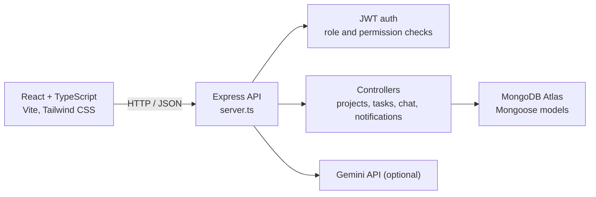

# PulseDev

A role-based workspace for planning sprints, reviewing work and keeping a small product team in sync.

PulseDev puts an initiative overview, a sprint board, a QA review step, team chat, notifications and an AI planning assistant in one web app. The main idea is that important actions, like QA approval and issue ownership, are checked on the server and not just hidden in the UI.

**Live demo:** https://pulsedev-jack.onrender.com

The demo runs on a free Render instance. If nobody has opened it for a while it goes to sleep, so the first load can take up to a minute.

## What is PulseDev?

PulseDev is a web app where a small software team keeps track of its work in one place.

Most teams end up with tasks in one tool, review feedback in another, and questions scattered across chat. Nobody is sure who is working on what, or whether a finished task was actually checked. PulseDev puts all of that on one screen and gives every person a view that matches their job.

### Who uses it

| Person | What they do in PulseDev |
| --- | --- |
| Team lead | Creates issues, assigns them, sets priorities, keeps the sprint moving |
| Developer | Sees the issues assigned to them, works on them, sends them for review |
| QA tester | Checks finished work and either passes it or sends it back with a reason |
| Product manager | Adjusts priority and scope of issues |
| Administrator | Looks after users and the audit log, and can override a step when really needed |

### A task from start to finish

Here is a made-up example, so you can see how the app works in practice.

The team is fixing a bug: the checkout total is rounded wrongly.

1. **The lead creates an issue.** Title: "Fix rounding in checkout total". Priority: high. Assigned to Marcus, a developer.
2. **Marcus finds it.** It shows up under "Assigned to me" on the sprint board. He moves it from Backlog to In Progress and leaves a comment about what he found.
3. **Marcus finishes and moves it to In Review.** Now it is waiting for QA.
4. **Sophia, the QA tester, checks it.** She finds that totals with discounts are still wrong. She rejects the issue and has to write a reason. The issue goes back to In Progress, keeps her feedback and the history of the rejection, and the people involved are notified.
5. **Marcus fixes it and sends it back to review.** Sophia checks again and passes it. The issue moves to Done.
6. **The overview updates.** The counts on the dashboard come from the real data, so the lead sees the sprint progress without asking anyone.

Now the part that matters most. Imagine Marcus gets impatient and tries to mark his own issue as Done without waiting for QA. The app says no and explains why: developers cannot ship an issue. This is checked on the server, not only in the buttons on screen, so it cannot be skipped by tampering with the page.

There is one exception. An administrator can ship an issue without a QA pass, but only after confirming a warning, and the action is written to the audit log with their name.

### Other things you can do

- **Chat with the team** in the app. Reply to a message, mention someone, attach a file.
- **Get notifications** about activity that concerns you, and see what you have already read.
- **Use the Planning Assistant.** For example, type "customers should be able to reset their password by email" and it drafts a list of tasks. It can also review an architecture or security idea and give you an interview question with an answer. Treat the output as a draft, not as a final answer.
- **Check the audit log** (admin only) to see who signed in, moved an issue or approved work, and when.
- **Use it on a phone.** The menu becomes a drawer, the board scrolls one column at a time, and long tables turn into stacked entries.

### How it works behind the scenes

In plain words:

1. You open the website. It is a single-page app built with React.
2. You sign in. The server checks your email and password and gives your browser a signed token that proves who you are.
3. Every time you do something (open a project, move an issue, send a message), the browser sends the request to the server together with that token.
4. The server checks two things: who you are and whether your role is allowed to do this. If not, it refuses with a short explanation.
5. If it is allowed, the server reads or saves the data in the database (MongoDB) and sends the result back.

Passwords are never stored as plain text. They are hashed before they are saved.

### What PulseDev is not

It is a portfolio project that shows how a role-based team tool can be built end to end. It is not a finished commercial product. There is no payment, no email sending, and some production features such as rate limiting and backups are still missing. The full list is in [Known limits](#known-limits).

## Try it

On the sign-in page, pick one of the sample accounts to see the app from that role's point of view. The demo password is shown on the sign-in page.

| Account | Title | Role |
| --- | --- | --- |
| Priya Patel | Staff Backend Lead | lead |
| Marcus Vance | Senior Software Engineer | developer |
| Sophia Laurent | QA Automation Lead | qa |
| Jordan Blake | Product Manager | guest |

These accounts are shared and public, so please do not enter anything private. Their password, email, role and deletion are locked on the server. The administrator account is not part of the demo.

You can also register your own account from the sign-in page.

A good way to try it: sign in as Marcus, move an issue to In Review, then open the site in a second window as Sophia and pass or reject it.

## Features

- **Overview:** a dashboard for the current project with real counts from the database.
- **Initiatives:** projects with a name, key, description, category and tags.
- **Active Sprint board:** issues move through Backlog, In Progress, In Review and Done. Search, priority filter and an "Assigned to me" filter are included.
- **QA review:** QA passes or rejects issues in review. A rejection needs a reason, keeps a history entry, sends the issue back to In Progress and notifies the people involved.
- **Role-based permissions:** each role can do different things on the board, and the API checks them again. A forbidden action returns a 403 with a short explanation, shown as a toast.
- **Audit log:** admin actions such as a QA override are recorded.
- **Team chat:** messages, replies, mentions and file attachments.
- **Notifications:** a notification center with read state per user.
- **Planning Assistant:** generate a draft backlog, ask for an architecture or security review, or get an interview question and answer. It uses Gemini when a key is set and falls back to built-in content when it is not.
- **Mobile layout:** the navigation is a drawer, the board scrolls one column at a time, and the audit log turns into stacked entries on small screens.

### Issue states

| State | Meaning |
| --- | --- |
| Backlog | Planned, not started |
| In Progress | Being worked on |
| In Review | Waiting for QA |
| Done | Passed QA, or shipped by an admin override |

Each issue has a title, description, assignee, priority, estimate, tags and comments. Rejected issues also keep QA feedback.

### Roles

| Role | What they can do |
| --- | --- |
| Admin | Manage issues and users, read the audit log, and ship without a QA pass after confirming the override. The override is logged. |
| Lead | Reassign and reprioritize issues, comment, and move work between Backlog, In Progress and In Review. Cannot ship an issue or return work from QA review. |
| Developer | Move only their own issues between Backlog, In Progress and In Review. Cannot ship an issue. |
| QA | Pass or reject issues that are in review. |
| Product Manager | Update priority and scope (description and tags) without changing status. |

An admin cannot sign in as another user. The app has no feature for that.

## How it is built



One Express server does everything. In development it runs Vite as middleware. In production it serves the built frontend from `dist/` and the same API routes.

| Area | Tools |
| --- | --- |
| Frontend | React 19, TypeScript, Vite, Tailwind CSS, Lucide icons, Motion |
| Backend | Node.js, Express, TypeScript |
| Auth | Signed JWTs, bcrypt, server-side role checks |
| Database | MongoDB Atlas with Mongoose |
| AI | Google Gemini through `@google/genai` (optional) |
| Hosting | Render (web service) and MongoDB Atlas |

### Project layout

```text
PulseDev/
├── backend/
│   ├── config/        # Mongoose models, database connection, seed and startup logic
│   ├── controllers/   # API handlers
│   ├── middleware/    # Auth, permissions, error handling
│   ├── routes/        # Express routes
│   └── scripts/       # One-time JSON to MongoDB importer
├── docker/            # Dockerfiles and compose file (see notes below)
├── frontend/
│   └── src/
│       ├── components/  # Shared UI, chat, notifications, role dashboards
│       ├── context/     # Auth and project state
│       ├── pages/       # Main screens
│       ├── services/    # API client
│       ├── theme/       # Role-based themes
│       └── utils/
├── .env.example
├── server.ts          # Express server and Vite integration
└── vite.config.ts
```

### API routes

Everything is under `/api`. Protected routes need a signed-in session.

| Route | Purpose |
| --- | --- |
| `/api/users` | Sign in, register, profile, team list, password change, admin user and audit operations |
| `/api/projects` | List and create projects, analytics, project tasks |
| `/api/tasks` | Create, update, comment, delete, QA pass and reject |
| `/api/messages` | Team chat |
| `/api/notifications` | Notifications and read state |
| `/api/ai` | Sprint generation, architecture review, interview Q&A |
| `/api/database` | Admin-only data inspector and reset tools |
| `/api/system` | Health check and diagnostics |

## Run it locally

You need Node.js 22.12 or newer, npm, and a MongoDB Atlas cluster.

```bash
npm ci
npm run dev
```

Create a `.env` file in the project root first (copy `.env.example`) and set at least `MONGO_URI`. Then open http://localhost:3000.

```env
MONGO_URI=mongodb+srv://<username>:<password>@<cluster-url>/pulsedev_dev?retryWrites=true&w=majority

# Optional locally. A persistent local secret is generated if you leave it out.
JWT_SECRET=<long random string>

# Optional. Without it the AI features return built-in fallback content.
GEMINI_API_KEY=<your key>
```

To generate a JWT secret:

```bash
node -e "console.log(require('crypto').randomBytes(48).toString('hex'))"
```

On the first run in development the app seeds a demo workspace (users, projects, tasks, chat) into the database. Use a separate database for local work, for example `pulsedev_dev`, so seeding never touches the live data.

### Atlas setup

1. Create a cluster and a database user that only has read and write access to your PulseDev database.
2. In Network Access, add your own IP address.
3. Put the connection string in `MONGO_URI`. If the username or password has special characters, URL-encode them.

Never commit `.env`, API keys or passwords.

### Scripts

| Command | What it does |
| --- | --- |
| `npm run dev` | Start the API and the frontend together |
| `npm run build` | Build the frontend into `dist/` |
| `npm start` | Start the server (used in production) |
| `npm run lint` | Type-check with `tsc --noEmit` |
| `npm test` | Run the schema, query-guard and demo-account tests (no database needed) |
| `npm run migrate:json-to-mongo` | One-time import of old local JSON data into an empty database |

The importer reads the six JSON collection files, inserts them in a transaction, refuses to run if any target collection already has documents, and leaves the original files alone.

Health check: `GET /api/system/health`

## Deploy

PulseDev is a single Node service, so it deploys as one web service. This is how the live demo is set up on Render.

| Setting | Value |
| --- | --- |
| Build command | `npm ci --include=dev && npm run build` |
| Start command | `npm run start` |
| Root directory | leave empty |

The start script runs `tsx`, which is a dev dependency, so the build command installs dev dependencies too.

### Environment variables

| Variable | Notes |
| --- | --- |
| `NODE_ENV` | `production` |
| `NODE_VERSION` | `22` (Render setting) |
| `MONGO_URI` | Atlas connection string with a user limited to this database |
| `JWT_SECRET` | Required in production. Use a long random value. |
| `GEMINI_API_KEY` | Optional |
| `DEMO_ACCOUNTS_PASSWORD` | Optional. Password for the four demo accounts, at least 6 characters |
| `VITE_DEMO_PASSWORD` | Optional. Same value as above, used at build time to show it on the sign-in page |

### First administrator

In production the app needs an administrator before it starts. Set these once:

```env
INITIAL_ADMIN_NAME=<your name>
INITIAL_ADMIN_EMAIL=<your email>
INITIAL_ADMIN_PASSWORD=<unique password, at least 16 characters>
```

After the first successful start the admin exists in the database. Remove the three `INITIAL_ADMIN_*` variables, since the plain-text password should not stay in the deployment settings. On startup the app also replaces the old built-in demo administrator.

### Demo accounts in production

Production startup locks the seeded demo accounts by default, because their development passwords were public. To let visitors use them:

- Set `DEMO_ACCOUNTS_PASSWORD` for the backend and `VITE_DEMO_PASSWORD` for the build, with the exact same value.
- Every start, the backend sets the password of Priya, Marcus, Sophia and Jordan to that value. It never applies it to an administrator.
- If `DEMO_ACCOUNTS_PASSWORD` is not set, those accounts stay locked. If `VITE_DEMO_PASSWORD` is not set at build time, the sign-in page hides the sample cards.
- The value ends up in the public frontend bundle, so treat it as public. Do not reuse a password you use anywhere else.

Redeploy after changing a `VITE_` variable, because it is read at build time.

### Database access on Render

Render's outbound IP ranges are shown in the service's Connect menu under Outbound. Add those ranges to the Atlas IP access list instead of allowing access from anywhere. Render has changed these ranges before, so if the database stops connecting after some time, check them again.

## Known limits

- It is a portfolio project, not a hardened production system. There is no rate limiting yet, no backup plan beyond what Atlas offers, and no monitoring.
- The demo accounts are shared. Anyone can change demo data, and an admin can reset it with the database tools.
- The free Render instance sleeps when idle.
- The Docker files are a starting point only. The compose file defines PostgreSQL and Redis, but the app uses MongoDB through `MONGO_URI`, so those containers do not do anything for the app.
- The Gemini features depend on your key and quota. Without a key they return fixed fallback content.
- Test coverage is small. It covers the schemas, the database query guard and the demo account rules.

## Ideas for later

- API and end-to-end tests for permissions, QA transitions and sign-in failures
- Rate limiting on sign-in and registration
- Backups, restore steps and basic monitoring
- Code splitting, because the main bundle is larger than 500 kB
- Fixing the Docker setup so it matches the real runtime

## Contributing

Keep authorization checks on the server, do not commit secrets, and update this README when setup steps or visible behavior change.